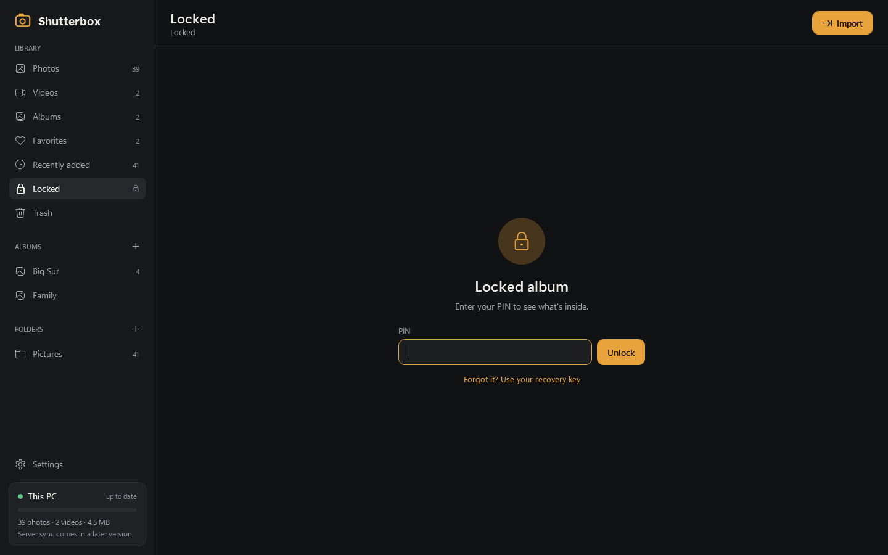
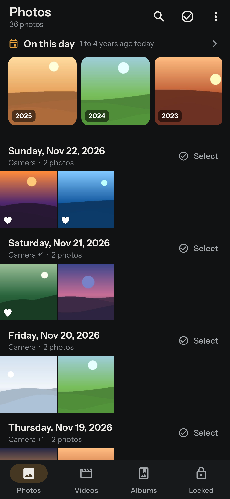
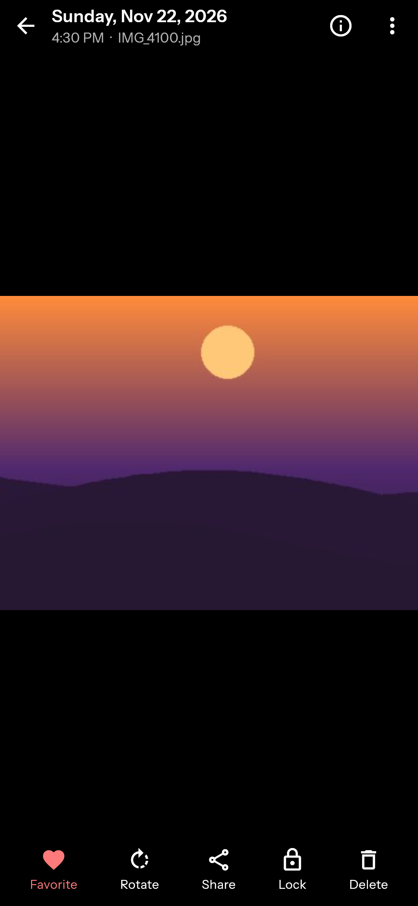
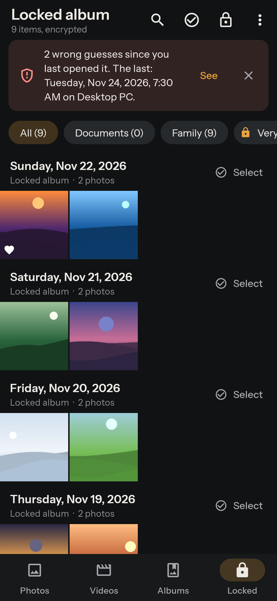
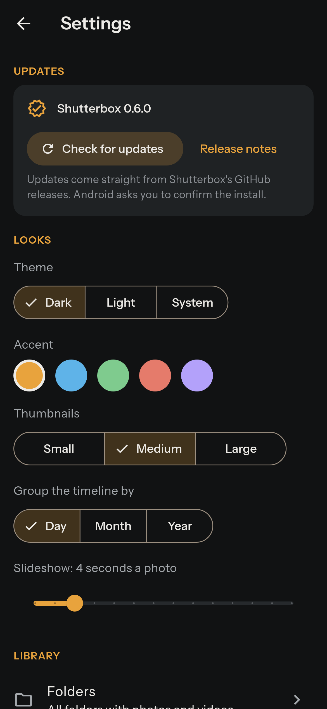

# Shutterbox

A photo and video organizer for Windows 10 and 11 and Android, by Bytehawk Studio.

Shutterbox shows the photos and videos already on your PC, with albums, favorites, tags, search, a viewer and slideshows, plus an encrypted **Locked album** for the ones that are nobody else's business. It reads your folders and never moves or changes your files.

**Download:** get the latest release from [Releases](https://github.com/adamglassner/shutterbox/releases), or install it from the **Bytehawk Studio Launcher**, which also keeps it up to date.

- `Shutterbox-<version>-Setup.exe`: installer (Start menu shortcut, uninstaller; choose "Install for me only" if you don't have administrator rights)
- `Shutterbox-<version>-win-x64.zip`: portable, just unzip and run `Shutterbox.exe`

Neither needs .NET installed.

**Android:** get `Shutterbox-Android-<version>.apk` from the newest `android-v…` release in [Releases](https://github.com/adamglassner/shutterbox/releases), open it on your phone and allow the install. After that, **Settings → Updates → Check for updates** installs new versions straight from GitHub (it also checks once a day). See [Shutterbox for Android](#shutterbox-for-android).


| Viewer | Albums | Light theme |
|---|---|---|
|  |  |  |

## Features

| | |
|---|---|
| **Library folders** | Choose the folders Shutterbox looks in (your Pictures folder, an external drive…). It finds the photos in them and their subfolders, and notices new, changed and deleted photos while it's open. If a drive is unplugged, its photos are kept until it's back. |
| **Timeline** | Newest first, grouped by **day, month or year**. Each day shows the folder it came from. Small, medium or large thumbnails. |
| **Details** | Date taken, camera, lens, exposure, size, GPS location (with a map link) and folder. Add a caption and tags. |
| **Search** | File names, folders, tags, captions, cameras, albums, months and years. Several words narrow it down (`canon portland`). |
| **Favorites** | Press **F** or click the heart. |
| **Albums** | A photo can be in any number of albums. Drag photos onto an album in the sidebar, or use **Add to album**. Pick any photo as the cover. |
| **Trash** | Deleted photos wait in Trash. Emptying it moves the files to the Windows Recycle Bin. |
| **Viewer** | Full window, zoom (mouse wheel or double-click) and pan, next/previous, rotate, favorite, edit in your photo editor, copy, open with. |
| **Slideshow** | Of everything, an album or a selection, oldest first, with crossfades. |
| **Import** | From a camera card, phone or folder. Copies into date folders (`2026\2026-10-14`), skips photos you already have and can clear the card afterwards. Or drop files and folders on the window. |
| **Videos** | Videos in your folders get their own **Videos** section, apart from your photos. Tiles show the length; the viewer plays them (play/pause, seek, mute). |
| **Locked album** | An encrypted album for private photos and videos, opened with a PIN, a password or Windows Hello. See below. |
| **Looks** | Dark (the default, so photos stand out) or Light, with five accent colours. |

Rotating in Shutterbox doesn't change the file; it's remembered in the library.

### Locked album

| Unlocked | Locked |
|---|---|
|  |  |

Select photos or videos and choose **Lock** (or drag them onto **Locked** in the sidebar). Shutterbox copies them into an encrypted album that only Shutterbox can open:

- **Unlock with** a PIN (4–12 digits) or a password, and optionally **Windows Hello** (fingerprint, face or Windows PIN) on each PC. A **recovery key** shown once at setup gets you back in if you forget the PIN or password. Nobody, including Bytehawk Studio, can open the album without one of these.
- **Encryption:** AES-256-GCM with a random key, in 1 MB pieces that are each authenticated (so changes or a cut-short file are detected). The key is stored only wrapped by your PIN/password (PBKDF2-SHA256, 600,000 rounds) and by the recovery key; Windows Hello keeps a copy protected for your Windows account (DPAPI). File names, dates and thumbnails are in the encrypted index, and the files on disk have random names.
- **Copy or Move:** the Lock menu has **Copy to Locked album** (your originals stay) and **Move to Locked album** (each item is encrypted and checked, then the original is deleted for good, not to the Recycle Bin). Both can go straight into one of the Locked album's albums.
- **Albums inside it:** tabs at the top of the Locked album (All, your albums, New album). Names are encrypted too and only show while it's unlocked.
- **Auto-lock** after 1, 5, 15 or 30 minutes without use (or only when you lock it), and always when Shutterbox closes.
- **Restore** decrypts items back to a folder you choose. **Delete** removes them for good (encrypted items don't go to the Recycle Bin).
- **Videos** play inside Shutterbox. A player needs a file, so while one plays it's decrypted to a hidden temporary file in `%LOCALAPPDATA%\Shutterbox\LockedPlayback`, deleted when you move on, lock or close Shutterbox (and at the next start if Windows shut down first).

**Cloud, other PCs and your phone.** The album is a single folder (`Shutterbox Locked album`). In **Settings → Locked album → Move to another folder** put it in your OneDrive, Dropbox or Google Drive folder, or on a USB drive. On another PC, choose **Use a Locked album from another PC**, pick that folder and unlock it; on Android, **Open a Locked album from a PC or another phone**. Windows Hello and fingerprint unlock are set up separately on each device. Since 0.4.0 each item's details are in their own encrypted file, so a PC and a phone can change the album at the same time through a synced folder without overwriting each other. The format is in [docs/locked-album-format.md](docs/locked-album-format.md).

**More privacy (0.4.0):**

- While it's unlocked, Shutterbox is **kept out of screenshots, recordings and screen sharing** (Settings → Locked album).
- **Lock it when you leave**: when Shutterbox is minimized, you switch apps or Windows locks. **Ctrl+Alt+L** anywhere locks it and hides Shutterbox.
- **Hide Locked** in the sidebar; open it with **Ctrl+Shift+L**, or type your PIN or password in search and press Enter.
- **Lock with Shutterbox** when you right-click photos and videos in File Explorer (Windows 11: Show more options). Up to 15 files at a time (a File Explorer limit).
- **Share for a moment**: Copy or Open with… makes temporary decrypted copies, deleted when it locks or Shutterbox closes.
- **Albums with their own PIN or password**: their items are re-encrypted with a key only that PIN opens. If it's forgotten they can't be recovered.
- **Captions, tags, favorites and search** for Locked album items, all encrypted.
- **Wrong guesses**: after 5 in a row Shutterbox makes you wait (30 seconds, doubling up to 15 minutes). Every wrong PIN, password or recovery key, on any device, is logged and you're told about them when you unlock. Optionally the camera **photographs wrong guesses**: the photo is encrypted to a public key whose private half is inside the album, so only someone who can unlock it can see them.
- **Check the album** (every file still decrypts, useful after syncing) and **Get a new recovery key**.

### File types

JPEG, PNG, GIF, BMP, TIFF, WebP, JPEG XR and ICO work out of the box. HEIC/HEIF (iPhone), AVIF and camera RAW files (DNG, CR2, CR3, NEF, ARW…) use the codecs Windows has, so install **HEIF Image Extensions**, **AV1 Video Extension** or **Raw Image Extension** from the Microsoft Store if they don't show. Videos use the codecs Windows has: MP4 (H.264), MOV, WMV and AVI play out of the box; HEVC (H.265, many phones), AV1 and VP9/WebM need **HEVC Video Extensions**, **AV1 Video Extension** or **VP9 Video Extensions** from the Microsoft Store.

### Selecting lots at once

- Point at a tile and click its **check circle** to add or remove it (no Ctrl needed).
- Turn on **Select mode** (the check button at the top): every click adds or removes, and you can drag across tiles to select them all.
- **Drag a box** from empty space to select everything it touches (hold Ctrl to add to the selection).
- **Select** on a day's heading, **Select all** in the selection bar, Ctrl+A, Shift+click for a range.

### Keyboard

| Key | Does |
|---|---|
| Click, Ctrl+click, Shift+click | Select |
| Arrow keys, Home, End, Page Up/Down | Move (Shift extends the selection) |
| Enter or double-click | Open |
| Ctrl+A / Esc | Select all / clear |
| Space | Add or remove the photo you're on |
| F | Favorite |
| R / Shift+R | Rotate right / left |
| Delete | Move to Trash |
| Ctrl+C | Copy the files |
| Ctrl+F | Search |
| Ctrl+I | Import |
| Ctrl+R | Rescan folders |
| F5 | Slideshow |
| Space / M | Play or pause / mute (in the viewer, for videos) |
| I | Show or hide the details panel |

In the viewer: Left/Right, + and − to zoom, 0 to fit, Space for the slideshow, Esc to go back.

## Shutterbox for Android

Everything above, on your phone (Android 7 or later). It shows the photos and videos in your phone's gallery (choose which folders in **Settings → Folders**), with the same timeline, Videos section, viewer, details, search, albums, Favorites, Recently added, Folders, Trash, slideshow and Locked album.

| Photos | Viewer | Locked album | Settings |
|---|---|---|---|
|  |  |  |  |

- **Selecting:** tap the check circles, or long-press a tile and drag across others (it scrolls as you go). **Select** on a day's heading, **Select all** in the selection bar.
- **Import:** a folder (a camera card or USB drive through an adapter) or chosen files, copied into `DCIM/Shutterbox/2026/2026-10-14`, skipping what you already have.
- **Trash:** emptying it deletes from your phone, into Android's own trash where it has one. **Move to Locked album** deletes the originals for good once they're encrypted and checked (Android asks you to allow it).
- **Locked album:** the same format as on Windows, so one album works on both, even at once through a synced folder. Also on the phone: keep it out of screenshots and the recent-apps preview, lock as soon as you leave or when the phone is put face down, hide the Locked tab (press and hold "Photos", or type the PIN in search), **Lock with Shutterbox** in Android's share menu, a camera whose photos go straight into the Locked album, share for a moment, albums with their own PIN, wrong-guess waits, log and photos, captions, tags, favorites and search. Unlock with your PIN, password or recovery key, and turn on fingerprint or face unlock on each phone. To use an album from your PC, copy its `Shutterbox Locked album` folder to the phone (USB, or a sync app), then **Locked → Open a Locked album from a PC or another phone** (or Settings → Locked album) and pick it. **Settings → Locked album → Move to another folder** puts the phone's album where you can copy or sync it to a PC. Android asks once for "All files access" for these.
- **Updates:** Settings → Updates. Android releases are tagged `android-v<version>`; the Windows releases (and the Bytehawk Studio Launcher) are unaffected.

The phone keeps its library, settings and Locked album in Shutterbox's own storage (removed if you uninstall it, so move the Locked album to a folder of your choice, or restore what's in it, before uninstalling).

## Where things are kept

| | |
|---|---|
| `%APPDATA%\Shutterbox\library.json` | Your library: folders, photo details, favorites, tags, captions, rotation, albums, Trash |
| `%APPDATA%\Shutterbox\settings.json` | Settings |
| `%APPDATA%\Shutterbox\Locked\` | The Locked album (encrypted), unless you moved it |
| `%APPDATA%\Shutterbox\hello.bin` | Windows Hello's copy of the Locked album key, protected for your Windows account (this PC only) |
| `%LOCALAPPDATA%\Shutterbox\thumbs\` | Thumbnail cache (safe to delete; Settings → Clear thumbnail cache) |

Uninstalling Shutterbox leaves these and your photos alone.

## Coming later

- **Shutterbox Server**: a server you run on your own PC or NAS to back up and sync your library and see it on your phone
- iOS app
- People (faces) and Places (map)

## Building

Requires the .NET 8 SDK and, for the installer, Inno Setup 6.

```powershell
.\build.ps1                 # exe, portable zip and installer in dist\
.\build.ps1 -SkipInstaller  # exe and zip only
```

Every push is built and tested by GitHub Actions on Windows: it runs `Shutterbox.exe --self-test`, which makes a folder of sample photos and drives the real window through scanning, the timeline, search, albums, Trash, import, the viewer and both themes, saving screenshots. Pushing a new `<Version>` in `src/Shutterbox/Shutterbox.csproj` to `main` (with a matching `## <version>` section in `CHANGELOG.md`) publishes a GitHub Release, which the Bytehawk Studio Launcher picks up.

### Building the Android app

It's a Flutter app in [`mobile/`](mobile). GitHub Actions (`.github/workflows/android.yml`) creates the Android project, runs the tests (including one that checks the phone's Locked album against a reference copy of the Windows format, `mobile/tool/vault_ref.py`), renders screenshots to the `screenshots-android` branch, builds and signs the APK, starts it on an emulator, and on `main` publishes `android-v<version>` when `mobile/pubspec.yaml` has a new version (with a matching section in `mobile/CHANGELOG.md`).

## Design

The original mockups (desktop, server admin, mobile) are in [`design/mockups`](design/mockups). They're source files for a Claude design canvas and need the canvas to render.

---

© 2026 Bytehawk Studio
