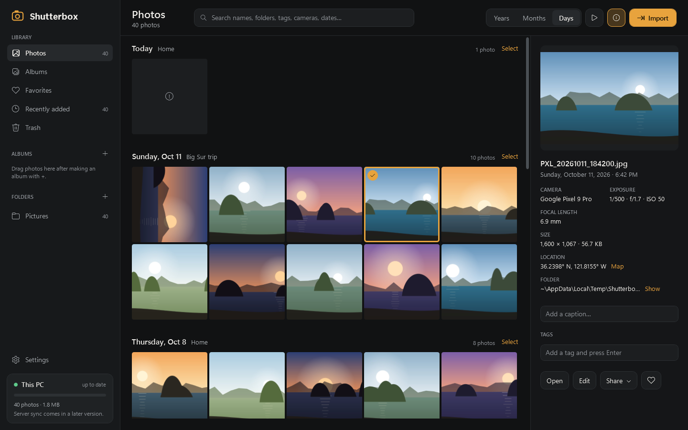
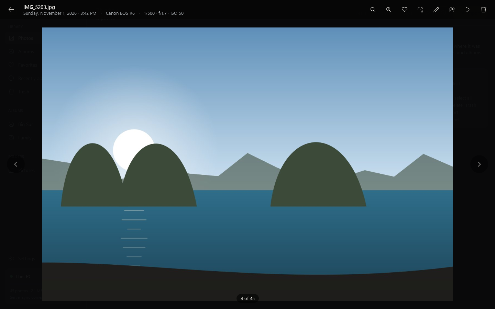
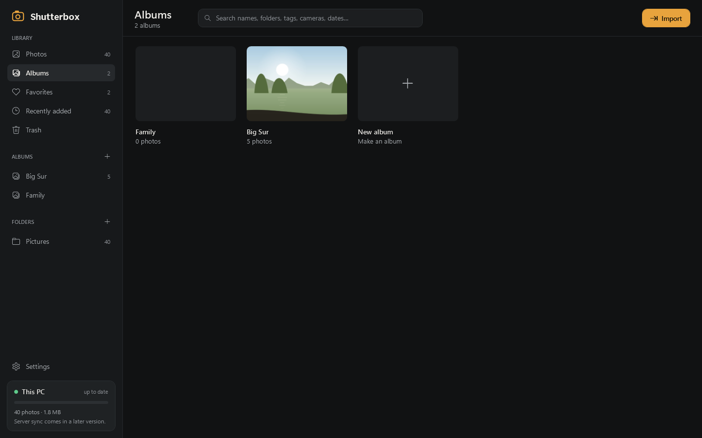
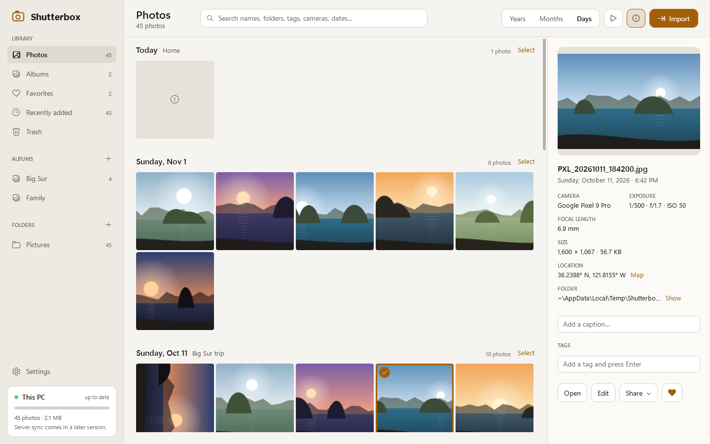
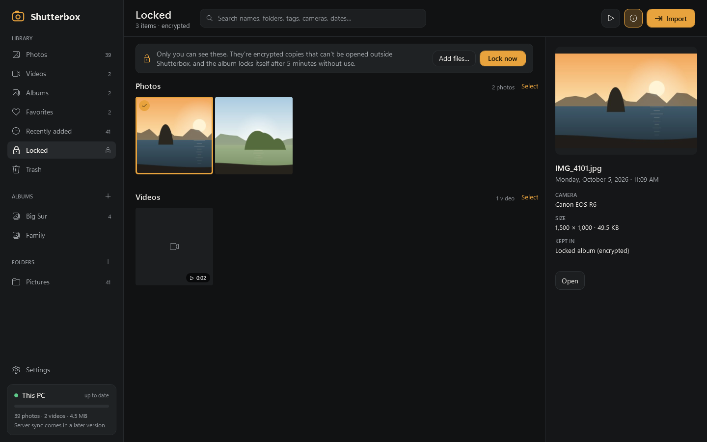

# Shutterbox

A photo and video organizer for Windows 10 and 11, by Bytehawk Studio.

Shutterbox shows the photos and videos already on your PC, with albums, favorites, tags, search, a viewer and slideshows, plus an encrypted **Locked album** for the ones that are nobody else's business. It reads your folders and never moves or changes your files.

**Download:** get the latest release from [Releases](https://github.com/adamglassner/shutterbox/releases), or install it from the **Bytehawk Studio Launcher**, which also keeps it up to date.

- `Shutterbox-<version>-Setup.exe`: installer (Start menu shortcut, uninstaller; choose "Install for me only" if you don't have administrator rights)
- `Shutterbox-<version>-win-x64.zip`: portable, just unzip and run `Shutterbox.exe`

Neither needs .NET installed.



| Viewer | Albums | Light theme |
|---|---|---|
|  |  |  |

## Features

| | |
|---|---|
| **Library folders** | Choose the folders Shutterbox looks in (your Pictures folder, an external drive…). It finds the photos in them and their subfolders, and notices new, changed and deleted photos while it's open. If a drive is unplugged, its photos are kept until it's back. |
| **Timeline** | Newest first, grouped by **day, month or year**. Each day shows the folder it came from. Small, medium or large thumbnails. |
| **Details** | Date taken, camera, lens, exposure, size, GPS location (with a map link) and folder. Add a caption and tags. |
| **Search** | File names, folders, tags, captions, cameras, albums, months and years. Several words narrow it down (`canon portland`). |
| **Favorites** | Press **F** or click the heart. |
| **Albums** | A photo can be in any number of albums. Drag photos onto an album in the sidebar, or use **Add to album**. Pick any photo as the cover. |
| **Trash** | Deleted photos wait in Trash. Emptying it moves the files to the Windows Recycle Bin. |
| **Viewer** | Full window, zoom (mouse wheel or double-click) and pan, next/previous, rotate, favorite, edit in your photo editor, copy, open with. |
| **Slideshow** | Of everything, an album or a selection, oldest first, with crossfades. |
| **Import** | From a camera card, phone or folder. Copies into date folders (`2026\2026-10-14`), skips photos you already have and can clear the card afterwards. Or drop files and folders on the window. |
| **Videos** | Videos in your folders get their own **Videos** section, apart from your photos. Tiles show the length; the viewer plays them (play/pause, seek, mute). |
| **Locked album** | An encrypted album for private photos and videos, opened with a PIN, a password or Windows Hello. See below. |
| **Looks** | Dark (the default, so photos stand out) or Light, with five accent colours. |

Rotating in Shutterbox doesn't change the file; it's remembered in the library.

### Locked album

| Unlocked | Locked |
|---|---|
|  |  |

Select photos or videos and choose **Lock** (or drag them onto **Locked** in the sidebar). Shutterbox copies them into an encrypted album that only Shutterbox can open:

- **Unlock with** a PIN (4–12 digits) or a password, and optionally **Windows Hello** (fingerprint, face or Windows PIN) on each PC. A **recovery key** shown once at setup gets you back in if you forget the PIN or password. Nobody, including Bytehawk Studio, can open the album without one of these.
- **Encryption:** AES-256-GCM with a random key, in 1 MB pieces that are each authenticated (so changes or a cut-short file are detected). The key is stored only wrapped by your PIN/password (PBKDF2-SHA256, 600,000 rounds) and by the recovery key; Windows Hello keeps a copy protected for your Windows account (DPAPI). File names, dates and thumbnails are in the encrypted index, and the files on disk have random names.
- **Originals:** locking copies. Shutterbox then offers to move the originals to the Recycle Bin; empty it afterwards so nothing is left behind.
- **Auto-lock** after 1, 5, 15 or 30 minutes without use (or only when you lock it), and always when Shutterbox closes.
- **Restore** decrypts items back to a folder you choose. **Delete** removes them for good (encrypted items don't go to the Recycle Bin).
- **Videos** play inside Shutterbox. A player needs a file, so while one plays it's decrypted to a hidden temporary file in `%LOCALAPPDATA%\Shutterbox\LockedPlayback`, deleted when you move on, lock or close Shutterbox (and at the next start if Windows shut down first).

**Cloud and other PCs.** The album is a single folder (`Shutterbox Locked album`). In **Settings → Locked album → Move to another folder** put it in your OneDrive, Dropbox or Google Drive folder, or on a USB drive. On another PC, choose **Use a Locked album from another PC**, pick that folder and unlock it. Windows Hello is set up separately on each PC. Use the album on one PC at a time: two PCs changing it at once through a cloud folder can overwrite each other's changes.

### File types

JPEG, PNG, GIF, BMP, TIFF, WebP, JPEG XR and ICO work out of the box. HEIC/HEIF (iPhone), AVIF and camera RAW files (DNG, CR2, CR3, NEF, ARW…) use the codecs Windows has, so install **HEIF Image Extensions**, **AV1 Video Extension** or **Raw Image Extension** from the Microsoft Store if they don't show. Videos use the codecs Windows has: MP4 (H.264), MOV, WMV and AVI play out of the box; HEVC (H.265, many phones), AV1 and VP9/WebM need **HEVC Video Extensions**, **AV1 Video Extension** or **VP9 Video Extensions** from the Microsoft Store.

### Keyboard

| Key | Does |
|---|---|
| Click, Ctrl+click, Shift+click | Select |
| Arrow keys, Home, End, Page Up/Down | Move (Shift extends the selection) |
| Enter or double-click | Open |
| Ctrl+A / Esc | Select all / clear |
| F | Favorite |
| R / Shift+R | Rotate right / left |
| Delete | Move to Trash |
| Ctrl+C | Copy the files |
| Ctrl+F | Search |
| Ctrl+I | Import |
| Ctrl+R | Rescan folders |
| F5 | Slideshow |
| Space / M | Play or pause / mute (in the viewer, for videos) |
| I | Show or hide the details panel |

In the viewer: Left/Right, + and − to zoom, 0 to fit, Space for the slideshow, Esc to go back.

## Where things are kept

| | |
|---|---|
| `%APPDATA%\Shutterbox\library.json` | Your library: folders, photo details, favorites, tags, captions, rotation, albums, Trash |
| `%APPDATA%\Shutterbox\settings.json` | Settings |
| `%APPDATA%\Shutterbox\Locked\` | The Locked album (encrypted), unless you moved it |
| `%APPDATA%\Shutterbox\hello.bin` | Windows Hello's copy of the Locked album key, protected for your Windows account (this PC only) |
| `%LOCALAPPDATA%\Shutterbox\thumbs\` | Thumbnail cache (safe to delete; Settings → Clear thumbnail cache) |

Uninstalling Shutterbox leaves these and your photos alone.

## Coming later

- **Shutterbox Server**: a server you run on your own PC or NAS to back up and sync your library and see it on your phone
- Android and iOS apps
- People (faces) and Places (map)

## Building

Requires the .NET 8 SDK and, for the installer, Inno Setup 6.

```powershell
.\build.ps1                 # exe, portable zip and installer in dist\
.\build.ps1 -SkipInstaller  # exe and zip only
```

Every push is built and tested by GitHub Actions on Windows: it runs `Shutterbox.exe --self-test`, which makes a folder of sample photos and drives the real window through scanning, the timeline, search, albums, Trash, import, the viewer and both themes, saving screenshots. Pushing a new `<Version>` in `src/Shutterbox/Shutterbox.csproj` to `main` (with a matching `## <version>` section in `CHANGELOG.md`) publishes a GitHub Release, which the Bytehawk Studio Launcher picks up.

## Design

The original mockups (desktop, server admin, mobile) are in [`design/mockups`](design/mockups). They're source files for a Claude design canvas and need the canvas to render.

---

© 2026 Bytehawk Studio
